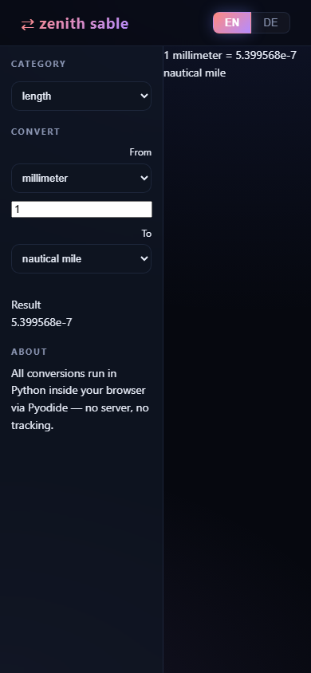

# Zenith Sable — Unit Forge

A universal unit converter (data focus) running Python in the browser via Pyodide. 8 categories, instant results, zero backend.

<div align="center">


-orange)


**[Live Demo](https://ruslanfridenli.github.io/zenith-sable/)** · **[Deutsch ↓](#-deutsch)**

</div>

---

## Screenshots




## Features

- Python-powered conversions via Pyodide (WebAssembly)
- 8 unit categories: length, weight, data, time, temperature, volume, speed, pressure
- Live formula readout
- Fully client-side — nothing leaves your browser
- English/German interface

## Local development

```bash
git clone https://github.com/ruslanfridenli/zenith-sable.git
cd zenith-sable
# open index.html in a browser, or serve statically:
npx serve .
```

No build step, no dependencies — pure static site.

---

## 🇩🇪 Deutsch

### Zenith Sable — Unit Forge

Ein universeller Einheitenumrechner (data-Fokus), der Python im Browser via Pyodide ausführt. 8 Kategorien, sofortige Ergebnisse, kein Backend.

### Funktionen

- Python-Umrechnungen via Pyodide (WebAssembly)
- 8 Kategorien: Länge, Gewicht, Daten, Zeit, Temperatur, Volumen, Geschwindigkeit, Druck
- Live-Formelanzeige
- Vollständig clientseitig — nichts verlässt deinen Browser
- Englische/deutsche Oberfläche

### Lokale Entwicklung

```bash
git clone https://github.com/ruslanfridenli/zenith-sable.git
cd zenith-sable
npx serve .
```

Reine statische Seite — kein Build-Schritt, keine Abhängigkeiten.

---

## ☕ Support / Unterstützen

Wenn dir diese Website beim Lernen hilft, würde mir eine Spende sehr viel bedeuten und dabei helfen, sie weiterzuentwickeln. Alternativ kannst du das Projekt mit einem Stern im github repo unterstützen. Vielen Dank!

- Solana: `zQpgZ6nGigww7vYpz3Qqxb1BT44kqS567vFaLTeHagS`
- Ethereum: `0x9c4fE1B2e9a1A9c22312c8296BB088Ca0e8F1B4e`
- Bitcoin: `bc1p2jltk9ya9kyzv35d8kxn7mmg9jqkx66cqtgzqwe75zlr4v9jk4hsv468q7`

---

Made with care. Feedback welcome via issues.
